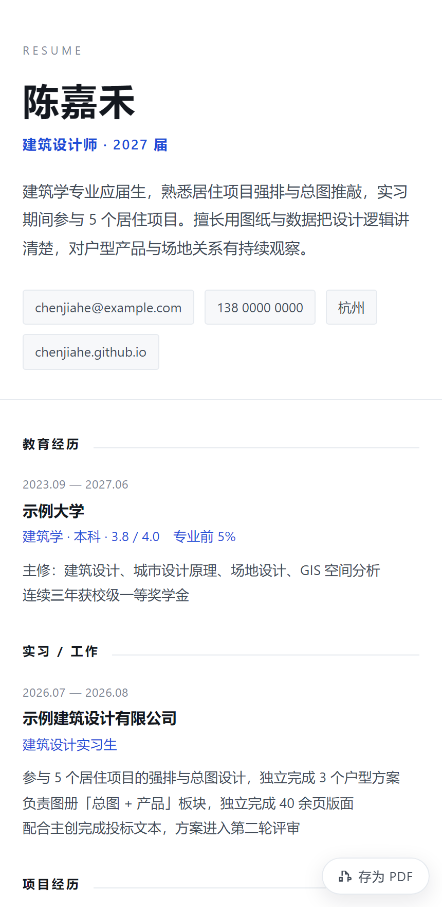
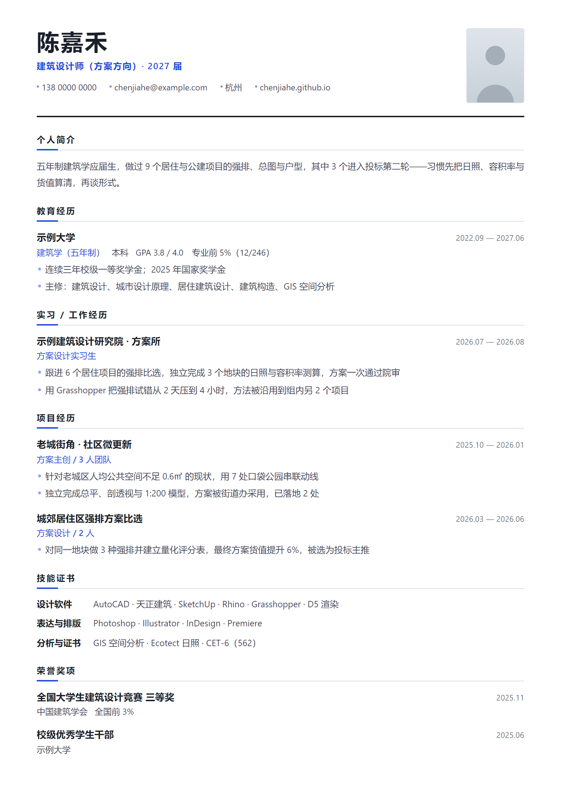

# 简历工坊 · Resume Studio

> 给大学生的简历与作品集工具：左边填表，右边实时看到 A4 成品。
> 一键导出 PDF 简历，**填完直接变成一个网址** —— 不用注册、不用买服务器、不用学会部署。
>
> **不注册、不上传、不联网。** 所有数据只存在你自己电脑的浏览器里。

### [→ 在线使用](https://nefelibata857.github.io/resume-studio/) · [→ 下载 ZIP](https://github.com/Nefelibata857/resume-studio/archive/refs/heads/main.zip)

<p align="center">
  
</p>

---

## 它解决什么问题

大学生做简历普遍卡在三个地方：

1. **Word 排版排不明白** —— 行距、对齐、分页永远调不好，导出还乱。
2. **作品集没地方放** —— 设计、建筑、视觉类专业的作品散在硬盘里，面试官看不到。
3. **填完变不成网站** —— 好不容易做了个网页，还要建仓库、开 Pages、拖文件，一步劝退。

这个工具把三件事连成一条线：

```
填写 → 实时预览 → 一键变网址 ──┬─→ 在线链接（点一下就有，无需托管）
                            └─→ 完整网页（带作品图，下载后托管）→ 二维码
                                    ↓
                      导出 PDF（简历 + 作品集页，页脚带二维码）
```

---

## 功能

| 功能 | 说明 |
| --- | --- |
| **实时预览** | 左边改一个字，右边 A4 立刻变。不用来回导出看效果 |
| **两套模板** | 「经典单栏」稳重通用；「双栏侧边」信息密度高，适合经历多的同学 |
| **A4 精确排版** | 按 210×297mm 设计，导出就是打印级，不会「差一点点」 |
| **导出 PDF** | 走浏览器打印，中文字体不会乱码、不会丢字 |
| **作品集页** | 图片自动排版成 2 / 3 列网格，自动压缩，附在简历后面一起出 PDF |
| **一键变网址** | 填完点一下就有个链接，**不用部署**。扫码或发链接都能看 |
| **完整网页** | 需要一个带作品图的独立网站时，下载单文件 HTML，拖到免费托管即可 |
| **二维码** | 为主页生成二维码，自动同步进简历，作品集页脚也会印上 |
| **自动保存** | 边填边存，关掉浏览器再打开还在 |
| **备份 / 导入** | 一份 JSON 带走全部内容，换电脑、发给同学都行 |
| **载入示例** | 不知道从哪开始？一键载入一份完整示例，照着改 |

### 一键变网址后，手机上长这样

<p align="center">
  
</p>

### 导出的作品集页长这样

简历后面自动跟一页（或多页）作品集，2 / 3 列网格，自动分页，页脚印你的二维码。

<p align="center">
  
</p>

### 一份填满的示例长这样

一页 A4 装下简介、教育、实习、两个项目、三组技能和荣誉 —— 这是工具的上限，不是你的上限。

<p align="center">
  
</p>

想直接看它对应的数据？`samples/` 里有两份：

| 文件 | 用法 |
| --- | --- |
| `samples/example-resume-architecture.json` | 在工具里点「导入」选中它，立刻得到上面这份完整简历（含 8 件作品） |
| `samples/example-homepage.html` | 由这份数据生成的个人主页，单文件，双击就能在浏览器里打开 |

来源是虚构人物「陈嘉禾」，所有占位图都是程序生成的图纸风格 SVG，不涉及任何真实作品。

---

## 怎么用

### 方式一：直接用（推荐）

打开线上版：**https://nefelibata857.github.io/resume-studio/**

### 方式二：下载到本地

1. 点右上角 **Code → Download ZIP**，解压
2. 双击 `index.html` —— 就这样，不用装任何东西

> 也可以直接克隆：
> ```bash
> git clone https://github.com/Nefelibata857/resume-studio.git
> cd resume-studio
> python -m http.server 8000    # 可选，起个本地服务器体验更完整
> ```

### 填写建议

- **个人信息**：姓名、手机、邮箱必填。个人主页可以等做完主页再回来填
- **经历描述**：**每行一条**，会自动变成项目符号列表。写「做了什么 + 结果如何」，用数字说话
- **技能**：输入后按回车添加，按退格删除
- **作品集**：支持一次多选上传，第一张自动作封面，建议单张控制在 1–2MB 内

### 导出

- **导出 PDF** → 在系统打印窗口里选「另存为 PDF」。边距选「无」，勾选「背景图形」效果最好
- **发布网站** → 点开后有两条路，见下一节
- **二维码** → 填入网址，下载 PNG，建议打印尺寸不小于 2cm × 2cm

---

## 把简历变成一个网站

点顶部「发布网站」，有两种走法，按需要选。

### 路线一：在线链接（推荐，点一下就好）

**不需要注册、不需要上传、不需要等审核。** 点「生成在线链接」，立刻得到一条网址：

```
https://nefelibata857.github.io/resume-studio/s.html#d=N4IgbiBcCMA0IAcoG0SAk0wkGqD7PE9BfeoIregfdGCF0YBB6gEP+CdpoBI
```

原理很直接：**把简历本身压缩后塞进网址里**。`s.html` 只是一张静态页面，谁打开这条链接，页面就在他自己浏览器里把内容还原成一份网页简历 —— 服务器上没有存任何东西，所以它永远不用「部署」。

- ✅ 复制就能发给 HR、发到微信，手机上自动变成单栏排版
- ✅ 页面里邮箱、手机号可点，自带「存为 PDF」按钮
- ⚠️ **只带文字**（简历 + 作品目录），不带作品图 —— 一张图几十 KB，塞进网址会把链接撑到十万字符
- ⚠️ 链接长度取决于内容量：极简简历约 200 字符（二维码能印在简历上），内容填满约 1500–2000 字符（二维码偏密，只适合屏幕扫）

**改完内容要重新点一次**，会生成一条新链接。旧链接不会跟着变 —— 这是「不存服务器」的代价，也意味着你随时可以「作废」一条链接，只要删掉它不发给别人。

### 路线二：完整网页（要作品图就走这条）

点「下载网页文件」，得到一个**单文件自包含 HTML**：图片、样式、脚本全在里面，不依赖任何外部资源。把它放到任意免费托管上，就是你的独立网站。

好处是带作品图、网址短（几十个字符，二维码好印）。代价是要做一次部署，也就一分钟：

<p align="center">
  
</p>

#### Netlify Drop（最快，30 秒）

打开 [app.netlify.com/drop](https://app.netlify.com/drop)，把下载的 html 文件拖进去，立刻拿到网址，**连账号都不用注册**。

#### GitHub Pages（免费、永久）

1. 新建仓库（Public）
2. 上传 `姓名-个人主页.html`，**重命名为 `index.html`**（关键）
3. Settings → Pages → Source 选 `Deploy from a branch` → Branch 选 `main` / `root`
4. 等 1–2 分钟，访问 `https://你的用户名.github.io/仓库名`

拿到网址后，回到「发布网站 → 完整网页」把网址粘进去，点「生成二维码」—— 二维码会自动写进简历，作品集 PDF 页脚也会带上。

---

## 隐私说明

- 没有任何后端、没有埋点、没有第三方请求，**断网也能用**
- 数据存在你浏览器的 IndexedDB 里，不会离开这台电脑
- 在线链接是把内容编码进网址本身，**没有被上传到任何服务器**；反过来说，**谁拿到这条链接，谁就能看到里面的全部内容** —— 发给谁由你决定，别往公开群里扔
- 完整网页部署到公网后，那部分内容自然就是公开的 —— 记得别把身份证号之类的信息填进去

---

## 技术说明

- **纯原生 HTML / CSS / JavaScript**，零框架、零构建、零依赖安装
- 刻意不用 ES Module，这样 `file://` 双击打开也能跑，不需要起服务器
- 存储：IndexedDB 优先；受限环境自动降级 localStorage；再不行就只在内存里（会提示你导出备份）
- 二维码：[qrcode-generator](https://github.com/kazuhikoarase/qrcode-generator)（MIT），已内置在 `assets/vendor/`
- 在线链接：字段名换下标 + 砍空值 + [LZString](https://github.com/pieroxy/lz-string)（MIT）压缩，放在 `#d=` 后面。一份填满的简历约 1.5–2 KB
- PDF：浏览器原生打印。**推荐 Chrome / Edge**，Safari 和 Firefox 的打印边距可能需要手动调

### 目录结构

```
resume-studio/
├── index.html              主界面
├── s.html                  在线简历阅读页（读 #d= 片段还原）
├── assets/
│   ├── css/
│   │   ├── app.css         工作台 UI 样式
│   │   ├── resume.css      简历/作品集版面 + 打印规则
│   │   └── share.css       在线简历阅读页样式（手机优先）
│   ├── js/
│   │   ├── util.js         工具函数、存储层、二维码封装
│   │   ├── schema.js       数据结构 + 表单定义 + 示例数据
│   │   ├── store.js        状态容器与自动保存
│   │   ├── form.js         表单渲染与交互
│   │   ├── templates.js    简历/作品集渲染（纯函数）
│   │   ├── share.js        简历 ⇄ 网址 的编码解码
│   │   ├── export.js       导出 PDF / JSON / 主页 / 二维码
│   │   └── app.js          主控装配
│   └── vendor/
│       ├── qrcode.js       二维码库（MIT）
│       └── lz-string.min.js 压缩库（MIT）
├── docs/                   README 用的预览图
└── README.md
```

想改模板？动 `assets/css/resume.css` 和 `assets/js/templates.js`，别的地方不用碰。
想改在线简历页？`s.html` + `assets/css/share.css`，数据从 `Share.fromHash()` 来。

---

## 常见问题

**导出的 PDF 换了电脑字体变了？**
打印走的是系统字体。Windows 上是微软雅黑，macOS 上是苹方，观感略有差异。要绝对一致就转成 PDF 之后再用（PDF 里字体已经固化）。

**内容超过一页怎么办？**
顶部会提示「简历占 N 页，建议精简」。应届生一页最稳，删掉和岗位无关的奖项和课程就行。

**在线链接太长，发出去变乱码/断掉了？**
有些聊天软件会截断超长网址。两条路：一是直接发 html 文件给对方；二是用「完整网页」部署，网址只有几十个字符。

**在线链接改内容会同步吗？**
不会。链接里装的是生成那一刻的内容快照，改完要重新生成一条。

**图片传不上去？**
单张请控制在 5MB 以内。超大的图会先压缩，压缩后仍然很大就会失败。

**换电脑了数据怎么带走？**
点「备份」导出 JSON，在新电脑上点「导入」。

---

## 贡献

Issue 和 PR 都欢迎。如果你觉得某个模板对学生不友好，或者想加「科研版」「英文版」模板，提上来一起改。

## License

[MIT](LICENSE) —— 随便用、随便改、随便发给同学。
