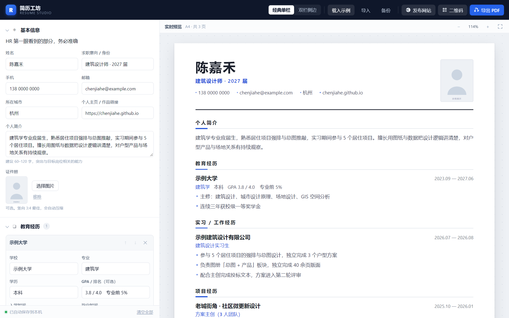
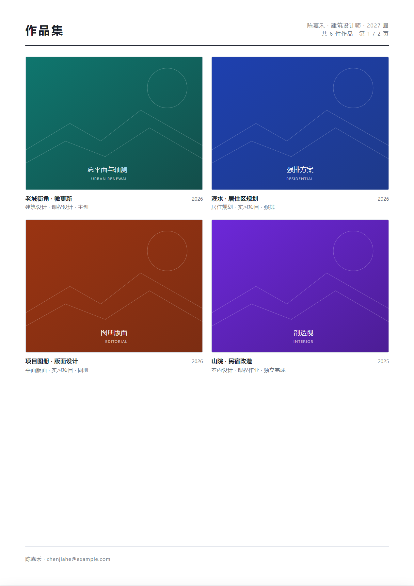
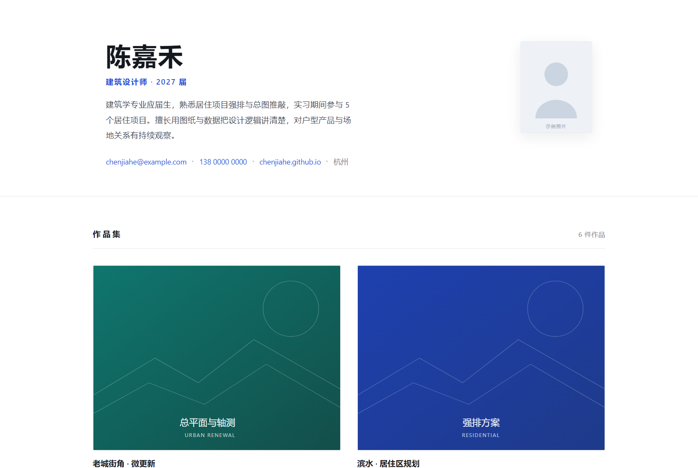

# 简历工坊 · Resume Studio

> 给大学生的简历与作品集工具：左边填表，右边实时看到 A4 成品。
> 一键导出 PDF 简历、生成**专属个人主页**和**二维码**。
>
> **不注册、不上传、不联网。** 所有数据只存在你自己电脑的浏览器里。

### [→ 在线使用](https://nefelibata857.github.io/resume-studio/) · [→ 下载 ZIP](https://github.com/Nefelibata857/resume-studio/archive/refs/heads/main.zip)

<p align="center">
  
</p>

---

## 它解决什么问题

大学生做简历普遍卡在三个地方：

1. **Word 排版排不明白** —— 行距、对齐、分页永远调不好，导出还乱。
2. **作品集没地方放** —— 设计、建筑、视觉类专业的作品散在硬盘里，面试官看不到。
3. **简历和作品集是两张皮** —— 投出去之后没法追溯，也没法让 HR「扫码看更多」。

这个工具把三件事连成一条线：

```
填写 → 实时预览 → 导出 PDF（简历 + 作品集页）
                  → 生成个人主页 HTML → 部署上线 → 生成二维码
                                                  ↓
                                    二维码印回简历 / 作品集页脚
```

---

## 功能

| 功能 | 说明 |
| --- | --- |
| **实时预览** | 左边改一个字，右边 A4 立刻变。不用来回导出看效果 |
| **两套模板** | 「经典单栏」稳重通用；「双栏侧边」信息密度高，适合经历多的同学 |
| **A4 精确排版** | 按 210×297mm 设计，导出就是打印级，不会「差一点点」 |
| **导出 PDF** | 走浏览器打印，中文字体不会乱码、不会丢字 |
| **作品集页** | 图片自动排版成 2 / 3 列网格，自动压缩，附在简历后面一起出 PDF |
| **专属个人主页** | 生成一个**单文件 HTML**，图片全部内嵌，丢到 GitHub Pages 就是你的个人网站 |
| **二维码** | 为你的主页生成二维码，自动同步进简历，作品集页脚也会印上 |
| **自动保存** | 边填边存，关掉浏览器再打开还在 |
| **备份 / 导入** | 一份 JSON 带走全部内容，换电脑、发给同学都行 |
| **载入示例** | 不知道从哪开始？一键载入一份完整示例，照着改 |

### 导出的作品集页长这样

简历后面自动跟一页（或多页）作品集，2 / 3 列网格，自动分页，页脚印你的二维码。

<p align="center">
  
</p>

---

## 怎么用

### 方式一：直接用（推荐）

打开线上版：**https://nefelibata857.github.io/resume-studio/**

### 方式二：下载到本地

1. 点右上角 **Code → Download ZIP**，解压
2. 双击 `index.html` —— 就这样，不用装任何东西

> 也可以直接克隆：
> ```bash
> git clone https://github.com/Nefelibata857/resume-studio.git
> cd resume-studio
> python -m http.server 8000    # 可选，起个本地服务器体验更完整
> ```

### 填写建议

- **个人信息**：姓名、手机、邮箱必填。个人主页可以等做完主页再回来填
- **经历描述**：**每行一条**，会自动变成项目符号列表。写「做了什么 + 结果如何」，用数字说话
- **技能**：输入后按回车添加，按退格删除
- **作品集**：支持一次多选上传，第一张自动作封面，建议单张控制在 1–2MB 内

### 导出

- **导出 PDF** → 在系统打印窗口里选「另存为 PDF」。边距选「无」，勾选「背景图形」效果最好
- **生成个人主页** → 下载 `姓名-个人主页.html`，按弹层里的三步部署指引上线
- **二维码** → 填入你的主页网址，下载 PNG，建议打印尺寸不小于 2cm × 2cm

---

## 部署你的个人主页

生成的 HTML 是**单文件自包含**的，图片都在里面，不需要任何服务器或数据库。

<p align="center">
  
</p>

### GitHub Pages（免费）

1. 新建仓库（Public）
2. 上传 `姓名-个人主页.html`，**重命名为 `index.html`**
3. Settings → Pages → Source 选 `Deploy from a branch` → Branch 选 `main` / `root`
4. 等 1–2 分钟，访问 `https://你的用户名.github.io/仓库名`

### Netlify Drop（更快，30 秒）

打开 [app.netlify.com/drop](https://app.netlify.com/drop)，把 html 文件拖进去，立刻拿到网址。

---

## 隐私说明

- 没有任何后端、没有埋点、没有第三方请求，**断网也能用**
- 数据存在你浏览器的 IndexedDB 里，不会离开这台电脑
- 唯一的例外：你把生成的 html 部署到公网，那部分内容自然就是公开的 —— 记得别把身份证号之类的信息填进去

---

## 技术说明

- **纯原生 HTML / CSS / JavaScript**，零框架、零构建、零依赖安装
- 刻意不用 ES Module，这样 `file://` 双击打开也能跑，不需要起服务器
- 存储：IndexedDB 优先；受限环境自动降级 localStorage；再不行就只在内存里（会提示你导出备份）
- 二维码：[qrcode-generator](https://github.com/kazuhikoarase/qrcode-generator)（MIT），已内置在 `assets/vendor/`
- PDF：浏览器原生打印。**推荐 Chrome / Edge**，Safari 和 Firefox 的打印边距可能需要手动调

### 目录结构

```
resume-studio/
├── index.html              主界面
├── assets/
│   ├── css/
│   │   ├── app.css         工作台 UI 样式
│   │   └── resume.css      简历/作品集版面 + 打印规则
│   ├── js/
│   │   ├── util.js         工具函数、存储层、二维码封装
│   │   ├── schema.js       数据结构 + 表单定义 + 示例数据
│   │   ├── store.js        状态容器与自动保存
│   │   ├── form.js         表单渲染与交互
│   │   ├── templates.js    简历/作品集渲染（纯函数）
│   │   ├── export.js       导出 PDF / JSON / 主页 / 二维码
│   │   └── app.js          主控装配
│   └── vendor/qrcode.js    二维码库（MIT）
├── docs/preview.png
└── README.md
```

想改模板？动 `assets/css/resume.css` 和 `assets/js/templates.js`，别的地方不用碰。

---

## 常见问题

**导出的 PDF 换了电脑字体变了？**
打印走的是系统字体。Windows 上是微软雅黑，macOS 上是苹方，观感略有差异。要绝对一致就转成 PDF 之后再用（PDF 里字体已经固化）。

**内容超过一页怎么办？**
顶部会提示「简历占 N 页，建议精简」。应届生一页最稳，删掉和岗位无关的奖项和课程就行。

**图片传不上去？**
单张请控制在 5MB 以内。超大的图会先压缩，压缩后仍然很大就会失败。

**换电脑了数据怎么带走？**
点「备份」导出 JSON，在新电脑上点「导入」。

---

## 贡献

Issue 和 PR 都欢迎。如果你觉得某个模板对学生不友好，或者想加「科研版」「英文版」模板，提上来一起改。

## License

[MIT](LICENSE) —— 随便用、随便改、随便发给同学。
